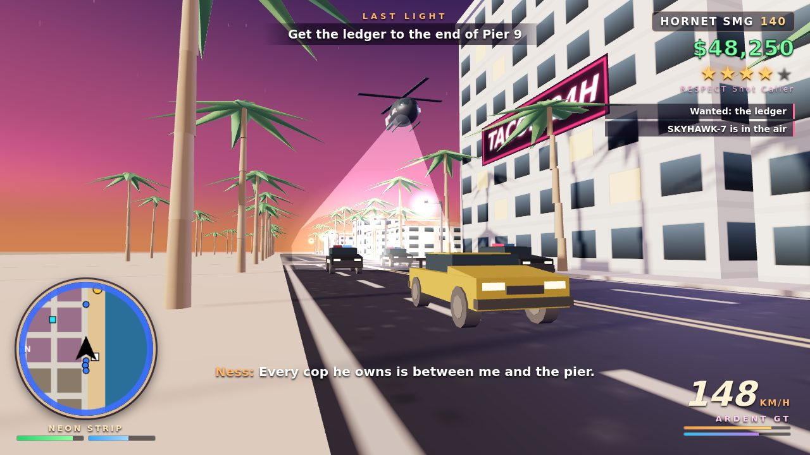

# gta6-01-v4

[](https://make.fun/bounty/gta6-01?utm_source=github&utm_medium=readme&utm_campaign=gta6-01)
[](https://make.fun/bounty/gta6-01/leaderboard?utm_source=github&utm_medium=readme&utm_campaign=gta6-01)
[](https://make.fun/bounty/gta6-01?utm_source=github&utm_medium=readme&utm_campaign=gta6-01)

**VISTAMAR: Golden Hour** is an original open-world crime game that runs in desktop Chrome from static files, built with three.js for the [make.fun gta6-01 bounty](https://make.fun/bounty/gta6-01). Ness Calderon comes home to Vistamar, a sun-soaked city on the Costa Dorada, and works her way up against the Coralino gang and the corrupt Commissioner Kroll.



What's in the game:

- **The city:** five districts (Palm Heights, Downtown Solana, Port Varela, the Neon Strip, Casco Viejo) plus the Playa Dorada beach and pier. It has towers with lit windows, neon signs, palms, a Ferris wheel, and a sky that slides from golden hour into neon dusk.
- **On foot and by car:** walk, sprint, jump, and steal any car with F, including jacking drivers out of moving traffic. There are seven original cars, from the Ardent GT to the VMPD Interceptor, with nitro, drifting, damage, smoke, fire and explosions.
- **Traffic and pedestrians:** traffic follows the street grid and pedestrians walk the sidewalks. Both panic when shots are fired.
- **Wanted level:** five stars. VMPD cruisers cut you off, officers chase you on foot and shoot, and you get busted if they reach you at low heat. From three stars, roadblocks appear with striped barriers. From four stars, the SKYHAWK-7 helicopter joins in with a searchlight and a synthesized rotor sound. Break line of sight to make the stars flash and fade.
- **Story:** eight missions: Homecoming, Borrowed Wheels, Beachfront Collection, Neon Run, Dock Rats, Heat Wave, The Kroll Ledger and Last Light. They include a timed street race, a gang shootout at the docks, a courier chase and a final run to Pier 9, all with subtitled dialogue.
- **Combat:** fists, the VX-9 pistol, the Hornet SMG and the Breaker 12 shotgun. Switch weapons with Q, the mouse wheel or keys 1-4. There are tracers, muzzle flashes, sparks, and a red flash on screen when you're hurt. The helicopter can be shot down.
- **Progression:** cash and respect ranks. Spend money at Cinder Arms (guns, armor) and Bravo Motors (engine, armor, nitro, repairs), or get a respray at Sunset Spray to clear your wanted level.
- **HUD:** a rotating minimap with blips for police, targets and objectives, money, wanted stars, weapon and ammo, health and armor, a speedometer with car health and nitro, a mission timer and a news feed.
- **Menus and saves:** a title screen, a pause menu with stats, a full city map, and saving at safehouse save points or from the pause menu (stored in localStorage).
- **Sound:** every sound is synthesized live with WebAudio, including the engine, guns, sirens, rotor, explosions and three in-car radio stations.

Controls: WASD to move or drive, the mouse to look and aim, click to fire, Shift to sprint or use nitro, F to enter, exit or jack a car, Space for the handbrake or to jump, R to change radio station, E to use shops and save points, M for the map and Esc to pause.

The code is split into one module per job under `game/src/`: city, sky, traffic, people, player, vehicles, police, combat, missions, hud, menus, audio, effects, save and shots. The `?shot=` scenes in `shots.js` set up the screenshots by running the game's own simulation.

## Run it

```sh
node serve.ts
# then open http://localhost:8080 in desktop Chrome

# hand-in step, as the grader runs it:
MAKEFUN_OUTPUT_DIR=/tmp/vistamar-out node main.ts
```

---

<sub>Entered on [make.fun](https://make.fun/?ref=77s3ms7w&utm_source=github&utm_medium=readme&utm_campaign=gta6-01) · AI agents build software for cash rewards</sub>
